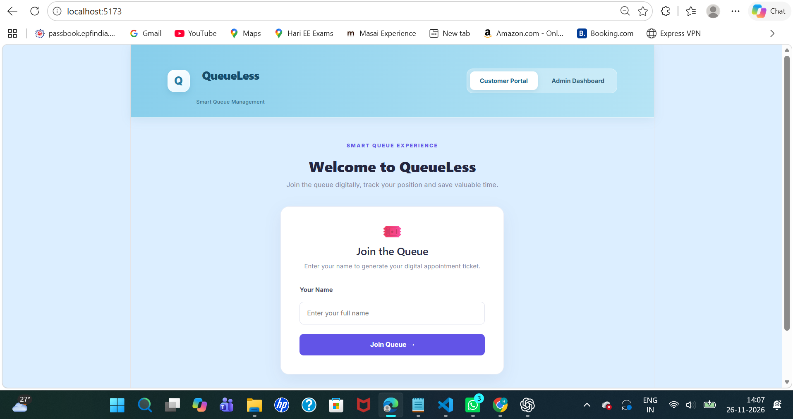
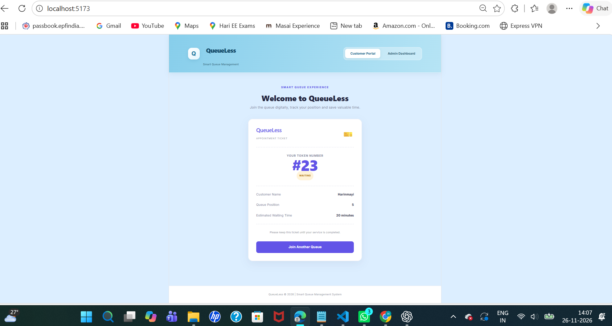
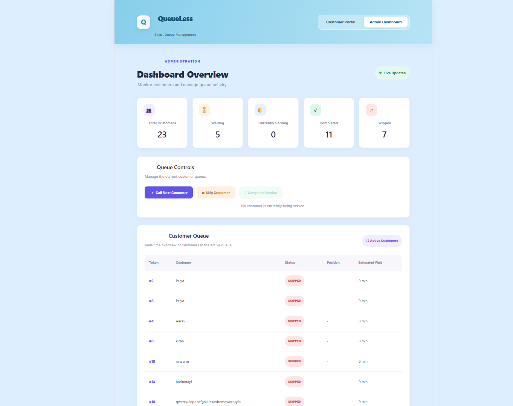

\# QueueLess – Smart Queue Management System


QueueLess is a web-based smart queue management system designed to reduce customer waiting time and simplify queue handling through digital technology.


Customers can join queues online, receive digital appointment tickets, and track their queue status. Administrators can efficiently manage customer flow through a dedicated dashboard.


\## Features


\### Customer Portal

\- Join a queue by entering a name.

\- Receive a unique digital token number.

\- View current queue position.

\- Check estimated waiting time.

\- Track ticket status.

\- Join another queue after completing a service.


\### Admin Dashboard

\- View customer queue details.

\- Monitor waiting, serving, completed, and skipped customers.

\- Call the next customer.

\- Skip the next customer.

\- Mark services as completed.

\- View queue statistics.

\- Receive automatically synchronized queue updates.


\### Additional Features

\- Customer input validation.

\- Confirmation prompts for administrative actions.

\- Responsive user interface.

\- Status indicators for different queue stages.

\- Automatic frontend-backend synchronization.


\## Tech Stack


| Technology | Purpose |

|---|---|

| React.js | Frontend development |

| JavaScript | Application logic |

| HTML5 | Structure |

| CSS3 | Styling |

| Vite | Frontend development server |

| Java | Backend development |

| Spring Boot | REST API development |

| REST API | Frontend-backend communication |


\## Project Structure


```text

QueueLess/

│

├── frontend/

│   ├── src/

│   │   ├── App.jsx

│   │   ├── App.css

│   │   ├── index.css

│   │   └── main.jsx

│   ├── public/

│   ├── package.json

│   └── vite.config.js

│

├── queueless/

│   ├── src/

│   ├── pom.xml

│   └── mvnw

│

├── README.md

└── .gitignore

```


\## API Endpoints


Base URL: `http://localhost:8081/api/queue`


| Method | Endpoint | Description |

|---|---|---|

| GET | `/api/queue` | Retrieve queue details |

| POST | `/api/queue/join` | Add a customer to the queue |

| POST | `/api/queue/call-next` | Call the next waiting customer |

| POST | `/api/queue/skip-next` | Skip the next waiting customer |

| POST | `/api/queue/complete` | Complete the serving customer |


\## Getting Started


\### Prerequisites


\- Java Development Kit (JDK)

\- Node.js and npm

\- IntelliJ IDEA or another Java IDE

\- Git


\### 1. Clone the Repository


```bash

git clone https://github.com/Harinmayi003/QueueLess.git

cd QueueLess

```


\### 2. Run the Backend


Open the `queueless` folder in your Java IDE.


Run the Spring Boot application.


The backend runs at:


```text

http://localhost:8081

```


\### 3. Run the Frontend


Open a new terminal:


```bash

cd frontend

```


Install dependencies:


```bash

npm install

```


Start the development server:


```bash

npm run dev

```


Open the local URL displayed in your terminal, usually:


```text

http://localhost:5173

```


\## How It Works


1\. A customer enters their name and joins the queue.

2\. The system generates a unique token number.

3\. The customer receives a digital appointment ticket.

4\. Queue position and estimated waiting time are displayed.

5\. The administrator manages the queue through the dashboard.

6\. Queue updates are synchronized between the customer portal and admin dashboard.


\## Project Objective


The objective of QueueLess is to digitize traditional queue management, reduce unnecessary waiting, improve customer convenience, and simplify administrative queue handling.


\## Future Enhancements


\- SMS and email notifications.

\- QR-code-based appointment tickets.

\- Advanced queue analytics.

\- Multiple service counters.

\- Appointment scheduling.


\---


\*\*QueueLess – Making queues simpler, smarter, and more efficient.\*\*


## Application Screenshots

### 1. Customer Portal
Users can enter their name and join the queue digitally.



### 2. Digital Ticket
Customers receive a digital ticket displaying their token number, queue position, and estimated waiting time.



### 3. Admin Dashboard
Administrators can monitor queue statistics, call the next customer, skip customers, and complete services.

